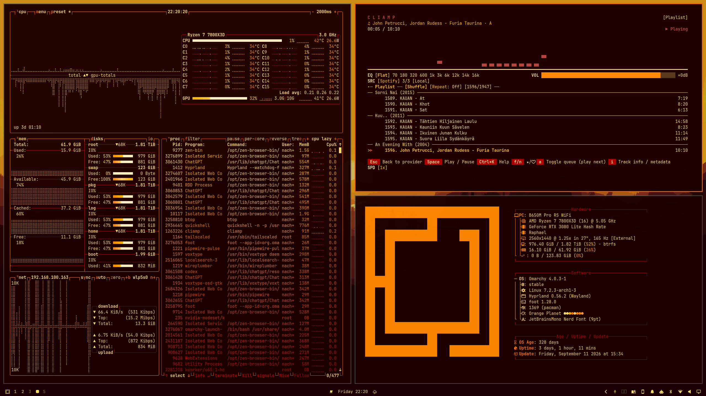
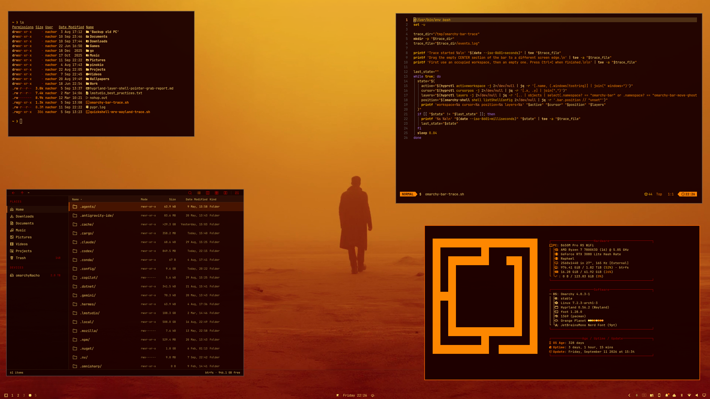

# Orange Planet

An amber-lit dark theme for [Omarchy](https://omarchy.org). Orange Planet pairs near-black red surfaces with glowing gold text and warm, high-contrast accents.

Created with [Aether](https://github.com/omacom/aether).

## Preview






## Install

Install from the terminal:

```sh
omarchy theme install https://github.com/NachoRodriguezM/omarchy-orange-planet-theme.git
```

Or open the Omarchy menu with `Super + Alt + Space`, choose **Install → Style → Theme**, and paste the repository URL. Then select **Orange Planet** from **Style → Themes**.

## Palette

| Role | Color |
| --- | --- |
| Background | `#1c0000` |
| Foreground | `#ffdd6b` |
| Accent | `#ed6100` |
| Selection | `#fff5c6` |
| Muted | `#ad0000` |
| Red | `#ff983b` |
| Yellow | `#ff8400` |
| Orange | `#ffa758` |
| Green | `#ff8800` |
| Cyan | `#ffb600` |
| Blue | `#ffd16b` |
| Magenta | `#ff7800` |
| Brown | `#996435` |

Omarchy generates matching application colors from `colors.toml`.

## Backgrounds

A curated selection of five backgrounds is included in [`backgrounds`](backgrounds).

## License

The Orange Planet theme configuration and documentation are released under the [MIT License](LICENSE). Background images remain the property of their respective creators and may be subject to their original licenses.
